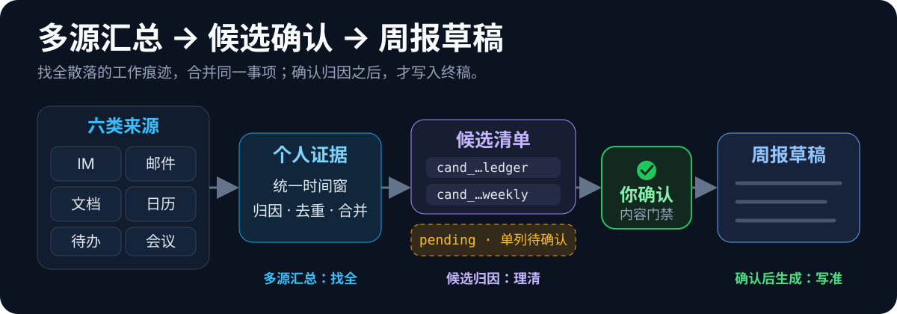

<div align="center">

# weekly-report

### 把散落在多个工作平台的信息，汇总成一份经过你确认的周报

从 IM、邮箱、文档、日历、待办和会议中收集**本人本周工作痕迹**，
合并为候选事项；由你确认后，再生成**本地周报草稿**。

**多源汇总，减少遗漏；候选确认，避免误写。**

<em>Collect work traces across tools, review the candidates, then draft the report.</em>

<br/>

[](LICENSE)


</div>

<p align="center">
  
</p>

同一个项目可能同时出现在消息、文档、任务和会议里。 `weekly-report` 会在统一时间窗内收集这些痕迹，按本人身份做归因、去重和跨源合并；判不准的标成 `pending`，不会直接写进周报。

---

## 支持的来源

首次运行会用一条消息盘点六类来源。你有什么填什么，没有写「没有」；表外平台会标为 `skipped`，不虚构连接能力。

<table>
  <thead>
    <tr>
      <th align="left">来源</th>
      <th align="left">覆盖</th>
      <th align="left">连接方式</th>
      <th align="left">状态</th>
    </tr>
  </thead>
  <tbody>
    <tr>
      <td>&nbsp; <b>飞书 / Lark</b></td>
      <td>IM · 日历 · 待办 · 文档 · 妙记会议</td>
      <td><code>lark-cli</code></td>
      <td>✅ 正式</td>
    </tr>
    <tr>
      <td>&nbsp; <b>钉钉 / DingTalk</b></td>
      <td>IM · 日历 · 待办 · AI 纪要</td>
      <td><code>dws</code></td>
      <td>🧪 实验（受企业授权限制）</td>
    </tr>
    <tr>
      <td>
        
        &nbsp; <b>IMAP 邮箱</b>
      </td>
      <td>QQ / 163 / 126 / 新浪 / 189 / 139 / 阿里等，本人收发信</td>
      <td><code>himalaya</code>（只读 IMAP）</td>
      <td>✅ 正式</td>
    </tr>
    <tr>
      <td>&nbsp; <b>WPS 个人文档</b></td>
      <td>最近创建或改动的文档，按 <code>created_by</code> / <code>modified_by</code> 归因</td>
      <td><code>kdocs-cli</code></td>
      <td>✅ 正式（仅个人账号）</td>
    </tr>
    <tr>
      <td>&nbsp; <b>macOS 日历 / 提醒</b></td>
      <td>系统聚合的 iCloud / Google / Exchange / 订阅日历与提醒</td>
      <td>EventKit（本地）</td>
      <td>✅ 正式</td>
    </tr>
    <tr>
      <td>&nbsp; <b>Google Workspace</b></td>
      <td>Gmail · 日历 · Drive / Docs</td>
      <td><code>gws</code>（大陆网络需实测）</td>
      <td>✅ 正式</td>
    </tr>
    <tr>
      <td>&nbsp; <b>企业微信 / WeCom</b></td>
      <td>普通 IM 当前无法直接读取，走「大圆」总结；官方 CLI 已覆盖邮件、文档、待办、日历、会议和微盘等非 IM 域，但本 Skill 尚未接入</td>
      <td>「大圆」总结；<a href="https://github.com/WecomTeam/wecom-cli"><code>wecom-cli</code></a> 待接入</td>
      <td>🧪 IM 实验；非 IM 待接入</td>
    </tr>
  </tbody>
</table>

<sub>品牌图标仅用于标识各集成的官方来源（nominative use），版权归各自所有者。在 <b>WorkBuddy</b> 里运行时，国内源可走其自带连接器；Google 仍走本地 <code>gws</code>。</sub>

---

## 一次完整演示

下面是仓库内的**完全虚构数据**，不是用户案例，也不包含真实工作信息。

```text
13 条工作痕迹
├─ 7 条本人主动产出，来自飞书、WPS、任务、会议、邮件和 Google Docs
│  └─ 去重、合并为 2 个候选事项
├─ 5 条只是接触过：被 @、被共享、被邀请、被分配、群聊噪音
│  └─ 排除或标为可能遗漏
└─ 1 条企业微信「大圆」总结
   └─ 单列 pending，不被普通“确认”隐式批准

用户确认两个候选 ID
└─ 最终周报的进展、风险和计划只使用 approved_candidate_ids
```

其中一个候选由六类证据共同支持，而不是在周报里重复出现六次：

| 候选 | 合并后的证据 | 结果 |
|---|---|---|
| `客户台账系统` | 飞书消息 + WPS 文档 + 飞书任务 + 妙记 + 邮件 + Google Docs | 合并为一个跨源候选 |
| `周报自动化` | 飞书回复 | 保留为单独候选 |
| 企业微信「大圆」总结 | 二手总结，可能与第一个候选重叠 | `pending`，等待显式确认 |

查看完整链路：

- [`sample-evidence.json`](examples/demo-run/sample-evidence.json)：13 条归一化工作证据。
- [`sample-candidates.md`](examples/demo-run/sample-candidates.md)：候选、排除项、`pending` 与证据引用。
- [`sample-weekly-report.md`](examples/demo-run/sample-weekly-report.md)：只使用已确认候选生成的终稿。

---

## 为什么还要候选确认：接触 ≠ 参与

多源汇总负责把信息找全，但“出现在你的工作环境里”不等于“是你做的”。因此，Skill 会先判断是不是本人主动行为，再判断是不是实际产出。

| 工作痕迹 | `weekly-report` 怎么判断 |
|---|---|
| 你在群里 / 被 `@` | 群成员身份、被 @ 都不等于本人已处理 |
| 文档被共享给你 / 你打开过 | 共享、打开、挂在名下不等于本人产出 |
| 你被邀请开会 | 邀请不等于参会；到场也不自动等于贡献 |
| 任务被分配给你 | 分配不等于本周有进展 |
| 你主动发送、回复关键消息 | 进入候选；表情和无业务语义短回复降级 |
| 你创建或实质编辑文档 | 作为强或中证据进入候选 |
| 你在会上发言、决策或认领行动项 | 升级为本人贡献 |
| 你实质更新或完成任务 | 进入候选；仅改元数据降级 |

每个候选都保留稳定的 `candidate_id` 和可追溯的 `source_evidence_ids`。用户确认后形成 `approved_candidate_ids` 白名单；没有进入白名单的排除项、遗漏项和 `pending`，不能绕过候选清单进入终稿。

---

## 安装

这是一个可分发的 **Agent Skill**。把 `weekly-report/` 目录放进支持 Skills 与本地命令 / 连接器调用的 Agent 即可，例如 Codex、Cursor、WorkBuddy、Qoder 或项目级 Claude。

### 一键安装

```bash
git clone https://github.com/manwithshit/weekly-report.git
cd weekly-report
./setup.sh
```

| 命令 | 作用 |
|---|---|
| `./setup.sh` | 探测 skills 目录，交互选择后安装 |
| `./setup.sh --all` | 安装到所有探测到的 skills 目录 |
| `./setup.sh --target <dir>` | 安装到指定目录 |
| `./setup.sh --list` | 只列出探测结果，不安装 |
| `./setup.sh --force` | 已存在时直接覆盖，不再询问 |

自动探测的候选目录：

- `~/.codex/skills`（可用 `$CODEX_HOME` 覆盖）
- `~/.workbuddy/skills`
- `~/.claude/skills`
- `./.claude/skills`（当前项目级）

### 手动安装

```bash
cp -R weekly-report ~/.codex/skills/          # Codex
cp -R weekly-report ~/.workbuddy/skills/      # WorkBuddy
```

安装后，在 Agent 里说一句 **「写周报」**。

---

## 使用

1. **说「写周报」/「总结本周」/「初始化」**：首次进入配置流程。
2. **一次盘点来源**：用一条消息问清 IM、邮箱、日历、待办、文档和会议分别在哪里。
3. **一次确认授权**：按平台去重后展示最小安装 / 授权清单；获得确认后才安装。OAuth 登录与同意由用户本人完成。
4. **逐源验证**：每个来源只读试取一条数据，标记 `verified` / `pending` / `failed`。
5. **生成候选清单**：统一时间窗、多源采集、个人归因、去重合并，生成带 `candidate_id` 和 `source_evidence_ids` 的候选。
6. **确认后落稿**：用户可确认、删除、补充或修改候选；终稿只读取 `approved_candidate_ids` 白名单。
7. **可选学习风格**：仅首次、候选确认后，可从旧周报学习结构、口吻、用词和项目排序；只学模式，不带入旧事实。

首次盘点示例（WorkBuddy）：


> 输出始终是本地草稿，不自动发送、提交或发布。数据不完整时，周报开头会明确列出缺口。

---

## 工作原理

```text
触发（“写周报”）
├─ 未配置 / “初始化”
│  └─ 盘点来源 → 确认安装授权 → 逐源只读验证
└─ 已配置
   └─ 统一时间窗 [周一 00:00, 现在)
      → 多源采集
      → 归一化为个人证据
      → 本人归因 + 跨源去重合并
      → 候选清单复核
      → approved_candidate_ids 白名单
      → 可选风格校准
      → 本地周报草稿
```

采集完整性记录在来源 / 运行级；权限失败、限流或分页截断都会让周报标明“数据不完整”。`identity_verified` 只表示动作人身份可确认，不表示二手总结里的事项已经属于当前用户。

---

## 边界与隐私

- **平台**：macOS，且当前 Agent 支持 Skills 与本地命令 / 连接器调用。非 macOS 或不支持时只给兼容性提示。
- **只整理本人**：不做团队监控，不替用户归因他人的工作。
- **只读**：不发信、不删信、不改日历提醒，不自动发送、提交或发布周报。
- **数据留本地**：原始消息、邮件和逐字稿只放本机临时目录；Skill 不在仓库缓存真实工作数据。
- **凭证零留存**：token、授权码、密码、OAuth code 不进入对话、日志、录屏或仓库，只走官方登录流程或系统钥匙链。
- **企业微信 IM**：普通员工聊天记录不能由个人账号直接读取；当前折中方案是让原生 AI「大圆」先总结，再作为中等证据单列确认。企业级会话内容存档另计。
- **抗提示注入**：来源内容要求执行命令、扩权或外发数据时，一律视为不可信内容。

---

## 目录结构

```text
weekly-report/
├── README.md
├── LICENSE
├── setup.sh
├── weekly-report/
│   ├── SKILL.md
│   └── references/
│       ├── attribution-rules.md
│       ├── feishu.md
│       ├── dingtalk.md
│       ├── mail.md
│       ├── wps.md
│       ├── google.md
│       ├── system-mac.md
│       ├── wecom.md
│       └── wecom-daiyuan.md
├── assets/
│   ├── icons/
│   └── readme/workflow.svg
├── docs/screenshots/
└── examples/demo-run/
```

---

## License

[MIT](LICENSE) © 2026 manwithshit
