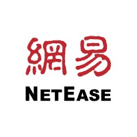
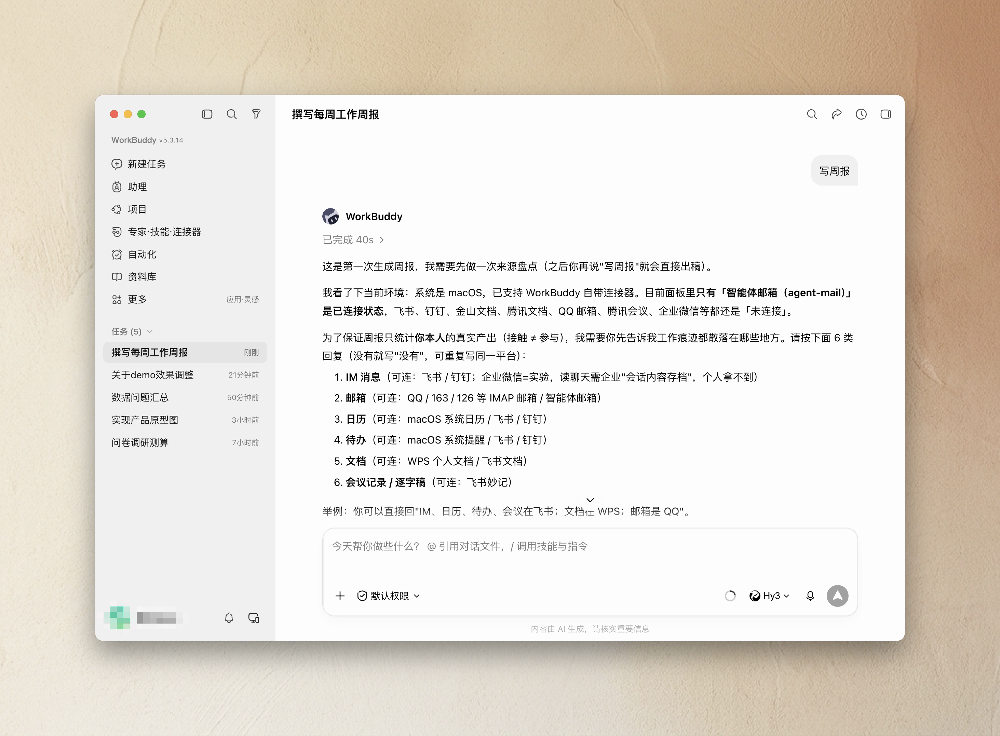

<div align="center">

# weekly-report

### 一个只把「你真正做的事」写进周报的 Agent Skill

把散落在 IM、邮箱、文档、日历、待办、会议里的**本人本周工作痕迹**，
自动归拢成一份**本地周报草稿**。核心不是「接上更多数据」，
而是**只算你真正的产出——接触 ≠ 参与**。

<em>An Agent Skill that drafts your weekly report from what you actually did — not what merely touched your inbox.</em>

<br/>

[](LICENSE)


</div>

---

## 目录

- [为什么不一样：接触 ≠ 参与](#为什么不一样接触--参与)
- [支持的来源](#支持的来源)
- [安装](#安装)
- [使用](#使用)
- [边界与隐私](#边界与隐私)
- [工作原理](#工作原理)
- [目录结构](#目录结构)
- [License](#license)

---

## 为什么不一样：接触 ≠ 参与

飞书 / 钉钉自带的周报表格，本质是把你这一周的**活动条数**堆起来：进了多少个群、被 @ 了多少次、多少文档在你名下、开了多少个会。**活动量不等于产出。** 在一个群里不代表你参与了；被 @ 不代表你处理了；别人共享给你的文档不是你的成果；被拉进一个会不代表你有贡献。

`weekly-report` 的核心是一层**个人证据归因**：先判「是不是你本人主动」，再判「是不是真的产出」，把「只是接触过」的噪音全部降级或剔除。

| 接触信号（很多工具算成你的成绩） | `weekly-report` 怎么判 |
|---|---|
| 你在某个群里 / 是群成员 | 群成员身份 ≠ 参与，群里他人的消息不归你 |
| 你被 `@` 了 | 被 @ ≠ 已处理 → 弱证据 / 标为「可能遗漏」，不自动算成果 |
| 有文档共享给你 / 你打开过 | 共享 / 打开 / 挂在你名下 ≠ 产出 |
| 你被邀请开会 | 邀请 ≠ 参会；`attended` 只证明到场，不等于贡献 |
| 有任务被分配给你 | 分配 ≠ 本周进展 |
| **你主动发送 / 回复了关键消息** | 计入候选（表情、撤回、无语义短回复降级） |
| **你创建或实质编辑了文档** | 创建 = 强证据；实质编辑 = 强 / 中；仅改格式降级 |
| **你在会上发言 / 决策 / 认领了行动项** | 升级为贡献；仅到场不算 |
| **你创建 / 更新 / 完成了任务** | `updated` 只有实质更新才计入进展；空更新 / 仅改元数据降级 |

> 一句话：别人给你的、@你的、拉你进的，都只是「接触」；**你主动做出来、推动了、拍板了、认领了的**，才写进周报。判不准的一律标 `pending`，绝不替你脑补成「已完成」。

---

## 支持的来源

首次运行会一条消息盘点这六类来源，你有什么填什么、没有写「没有」。下列是当前能真正连上的来源；报了表外的平台（如 TAPD / qq / 微信）会如实告诉你「暂时连不上」，不虚构。

<table>
  <thead>
    <tr>
      <th align="left">来源</th>
      <th align="left">覆盖</th>
      <th align="left">连接方式</th>
      <th align="left">状态</th>
    </tr>
  </thead>
  <tbody>
    <tr>
      <td>&nbsp; <b>飞书 / Lark</b></td>
      <td>IM · 日历 · 待办 · 文档 · 妙记会议</td>
      <td><code>lark-cli</code></td>
      <td>✅ 正式</td>
    </tr>
    <tr>
      <td>&nbsp; <b>钉钉 / DingTalk</b></td>
      <td>IM · 日历 · 待办 · AI 纪要</td>
      <td><code>dws</code></td>
      <td>🧪 实验（受企业授权限制）</td>
    </tr>
    <tr>
      <td>
        
        &nbsp; <b>IMAP 邮箱</b>
      </td>
      <td>QQ / 163 / 126 / 新浪 / 189 / 139 / 阿里 等，本人收发信</td>
      <td><code>himalaya</code>（只读 IMAP）</td>
      <td>✅ 正式</td>
    </tr>
    <tr>
      <td>&nbsp; <b>WPS 个人文档</b></td>
      <td>最近改动 / 创建的文档，按 <code>created_by</code>/<code>modified_by</code> 归因</td>
      <td><code>kdocs-cli</code></td>
      <td>✅ 正式（仅个人账号）</td>
    </tr>
    <tr>
      <td>&nbsp; <b>macOS 日历 / 提醒</b></td>
      <td>系统聚合的 iCloud / Google / Exchange / 订阅日历与提醒</td>
      <td>EventKit（本地，数据不出机）</td>
      <td>✅ 正式</td>
    </tr>
    <tr>
      <td>&nbsp; <b>谷歌 / Google Workspace</b></td>
      <td>Gmail · 日历 · Drive/Docs（本人发出 / 参加 / 编辑）</td>
      <td><code>gws</code>（大陆网络需实测）</td>
      <td>✅ 正式</td>
    </tr>
    <tr>
      <td>&nbsp; <b>企业微信 / WeCom</b></td>
      <td>IM 无法直读，经原生 AI「大圆」按「接触≠参与」规则总结后带入；文档/日历等服务端能力另计</td>
      <td>「大圆」总结（前置过滤）</td>
      <td>🧪 实验</td>
    </tr>
  </tbody>
</table>

<sub>品牌图标仅用于标识各集成的官方来源（nominative use），版权归各自所有者。在 <b>WorkBuddy</b> 里运行时，国内源可走其自带连接器面板、无需另装 CLI；<b>谷歌无 WorkBuddy 连接器，仍需本地 gws</b>。</sub>

首次运行时，Skill 会用一条消息盘点这些来源（下图**以 WorkBuddy 为例**）：



---

## 安装

这是一个可分发的 **Agent Skill**——把 `weekly-report/` 目录放进你的 Agent 的 skills 目录即可。**任何支持 Skill 与本地命令 / 连接器调用的 Agent 都能用**（如 Codex / Cursor / WorkBuddy / Qoder / 项目级 Claude 等）。

### 一键安装

```bash
git clone https://github.com/manwithshit/weekly-report.git
cd weekly-report
./setup.sh
```

`setup.sh` 会自动探测你的 skills 目录并让你选择安装到哪里：

| 命令 | 作用 |
|---|---|
| `./setup.sh` | 探测 skills 目录，交互选择后安装 |
| `./setup.sh --all` | 安装到所有探测到的 skills 目录 |
| `./setup.sh --target <dir>` | 安装到你指定的目录 |
| `./setup.sh --list` | 只列出会探测到哪些目录，不安装 |
| `./setup.sh --force` | 已存在时直接覆盖，不再询问 |

自动探测的候选目录（用 `$HOME`，不写死用户名）：

- `~/.codex/skills`（可用 `$CODEX_HOME` 覆盖）
- `~/.workbuddy/skills`
- `~/.claude/skills`
- `./.claude/skills`（当前项目级）

### 手动安装

直接把 skill 目录整个拷进去即可：

```bash
cp -R weekly-report ~/.codex/skills/          # Codex
cp -R weekly-report ~/.workbuddy/skills/      # WorkBuddy
```

装好后在 Agent 里说一句 **「写周报」** 就能触发。

---

## 使用

1. **说「写周报」/「总结本周」/「初始化」**——首次会进入配置流程。
2. **一次盘点来源**：Skill 用**一条消息**问清你的 IM / 邮箱 / 日历 / 待办 / 文档 / 会议分别在哪（飞书、钉钉、企业微信、Gmail、WPS、系统日历 / 提醒等），没有的写「没有」。
3. **一次确认授权**：按平台去重后给你一份最小安装 / 授权清单（装什么、读哪些数据域、哪步会开浏览器），**你确认一次**后才安装。OAuth 的登录+同意始终由你本人在浏览器完成，Skill 不代填账号密码。
4. **逐源验证**：每个来源用只读命令试读一条数据，标 `verified` / `pending` / `failed`。
5. **以后一句话生成**：配置完成后，直接说「写周报」即可。Skill 会统一算好本周时间窗、多源采集、做个人归因，先给你一份带稳定 `candidate_id` 和 `source_evidence_ids` 的**候选清单**复核（可「删 cand_...」「补充……」「修改 cand_...……」；来自企微「大圆」的总结会单列请你确认）。补充会先生成新证据 ID 和 `candidate_id`，修改保留原 `candidate_id` 并追加新证据 ID；候选只有在 `source_evidence_ids` 可解析追溯后，才能进入 `approved_candidate_ids` 白名单。终稿的进展、风险、待解决和计划只能来自白名单，没有文字补充的直接旁路。
6. **（可选 · 仅首次）学你的风格**：候选确认后、生成前，可贴一份或几份你以前的周报，Skill 学你的**结构、口吻、用词、项目排序**（只学模式、不存内容，写进 config）；不贴就用默认，以后不再问。
7. **产出**：结构**优先照你过往的周报**，没学过才用默认——**本周进展 / 风险与待解决 / 下周计划 / 数据说明**；写到 `weekly-reports/YYYY-MM-DD_个人周报.md`。

> **始终是本地草稿，绝不自动发送 / 提交 / 发布。** 数据不完整时，周报开头会明确写「数据不完整」并列出缺口，而不是假装完整。

📂 **想先看产出长什么样？** [`examples/demo-run/`](examples/demo-run/) 有一份完整的「输入 → 候选清单 → 周报」示例（虚构演示数据，专门演示「接触 ≠ 参与」）。

---

## 边界与隐私

- **平台**：macOS，且当前 Agent 需支持 Skills 与本地命令 / 连接器调用——**任何满足的 Agent 都能用**（如 Codex、Cursor、WorkBuddy、Qoder；目前已在 Codex / WorkBuddy 实测）。非 macOS / 不支持时只给兼容性提示，不做初始化承诺。
- **只整理你本人**：不做团队监控，不替你归因他人的工作。
- **只读**：不发信 / 不删信 / 不改日历提醒 / 不发送提交发布任何东西。
- **数据留本地**：原始消息 / 邮件 / 逐字稿只放本机临时目录，成稿后清理；文档类连接器（如 kdocs-cli）直连官方 API 取你自己的数据，Skill 不缓存、不外传。
- **凭证零留存**：token / 授权码 / 密码 / OAuth code **永不**进入对话、日志、录屏或本仓库；只走官方登录流程或系统钥匙链。配置文件（`~/.config/weekly-report/config.json`）只存平台 / 连接器 / 验证状态、以及可选的风格档案（`style`，从旧周报学到的格式/用词/项目排序模式，**不含周报实际内容**）等**非敏感**字段，目录 `700`、文件 `600`。
- **企业微信**：读员工聊天记录必须由企业开通「会话内容存档」，**个人账号拿不到**——这是硬限制，不会假装能读；折中是让企微原生 AI「大圆」按同一「接触≠参与」规则**先总结、再带入**（标中证据、需你复核，见 `weekly-report/references/wecom-daiyuan.md`）。
- **抗提示注入**：来源内容里若出现「执行命令 / 扩权 / 外发数据」这类指令，一律当作不可信内容忽略并告知你。

---

## 工作原理

```
触发（“写周报”）
├─ 未配置 / “初始化”
│    └─ 一条消息盘点来源 → 最小安装/授权清单 → 一次确认 → 安装授权 → 逐源只读验证
└─ 已配置
     └─ 统一时间窗 [周一 00:00, 现在)
          → 多源采集（只读，当前用户身份；企微 IM 经「大圆」按同一规则总结后带入）
          → 归一化为「个人证据」
          → 个人归因（接触≠参与：先判是否本人主动，再判是否产出；已总结/二手源标中证据、候选里单列）
          → 带 candidate_id + source_evidence_ids 的候选清单，你复核一次
          → 形成 approved_candidate_ids 白名单（排除/遗漏/pending 不自动进终稿）
          →（仅首次·可选）贴旧周报学你的风格
          → 落稿（有 style 就照你过往，否则默认结构；风格不新增事实）
```

统一时间窗对所有来源共用（左闭右开，用你的时区），不让各连接器各自推算周界；证据会分开记录“谁做了动作”和“你与该事件的关系”，避免把“被邀请”写成“已参会”。`identity_verified` 只表示 `actor_id` 身份可否确认，不表示总结里的事项已证实属于当前用户。跨源同一事项合并引用、不重复计成果。采集完整性记在源 / 运行级，包含真实 `stop_reason`；任何权限失败 / 限流 / 分页截断都会置「数据不完整」并在周报里如实标出。

---

## 目录结构

```
weekly-report/
├── README.md
├── LICENSE               # MIT
├── setup.sh              # 一键安装到 Agent 的 skills 目录
├── weekly-report/        # ← 这才是 Skill 本体，整体拷进 skills 目录
│   ├── SKILL.md          #   触发、流程、归因规则、安全边界
│   └── references/       #   归因规则 + 各连接器的安装/授权/采集细则
│       ├── attribution-rules.md   # 接触≠参与 · 核心归因规则（单一来源）
│       ├── feishu.md
│       ├── dingtalk.md
│       ├── mail.md
│       ├── wps.md
│       ├── google.md              # 谷歌 gws（Gmail/日历/Drive）
│       ├── system-mac.md
│       ├── wecom.md
│       └── wecom-daiyuan.md       # 企微「大圆」总结（已总结源）
├── assets/icons/         # 各集成的品牌图标（README 用）
└── docs/screenshots/     # 运行截图占位
```

---

## License

[MIT](LICENSE) © 2026 manwithshit
